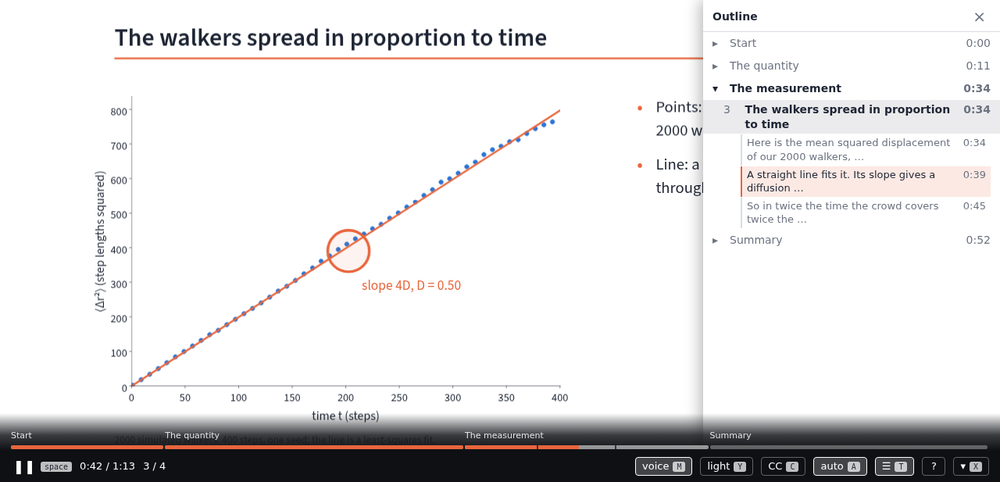
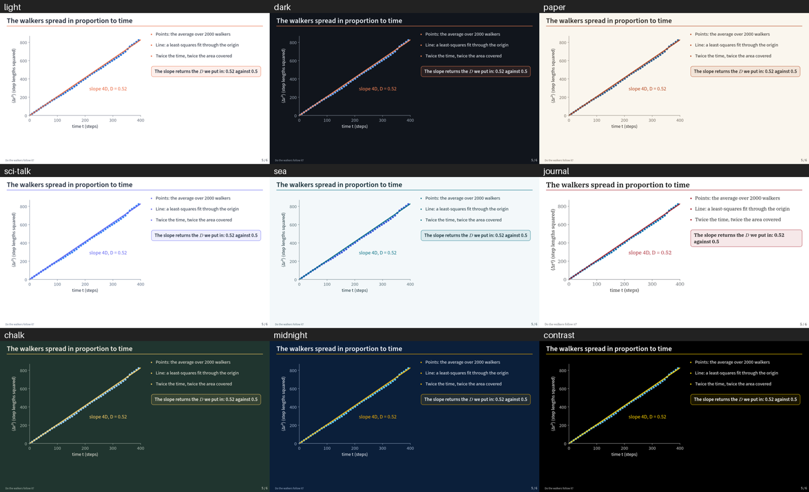

# sci-narrated-talk

A scientific talk that tells itself: a Quarto + reveal.js deck in which a synthetic
voice narrates every slide, sentence by sentence, while the slide builds. The result is
an HTML page that opens offline, with its voices in a folder beside it (or a one-file
copy with the voice, the clips or both inside). The viewer can let it run like a video, steer it like a deck, pick
another voice, or present it by hand with none.



`SKILL.md` tells Claude how to make such a talk. This file explains what the skill
contains, how the pieces fit, and what has and has not been tested.

## Install

It needs [Claude Code](https://claude.com/claude-code), Git,
[uv](https://docs.astral.sh/uv/) and [Quarto](https://quarto.org/docs/get-started/)
1.4 or newer, and Chrome, Chromium or Edge for the build's check. On Windows uv and
Quarto install with `winget install astral-sh.uv Posit.Quarto`.

In Claude Code, on any system:

```
/plugin marketplace add ehsanirani/sci-narrated-talk
/plugin install sci-narrated-talk@sci-narrated-talk
```

Start Claude Code again. `/plugin marketplace update sci-narrated-talk` fetches a newer
version later. The other way is a clone into the skills folder, updated with `git pull`
(one way or the other, not both, or the skill is there twice):

```sh
git clone https://github.com/ehsanirani/sci-narrated-talk ~/.claude/skills/sci-narrated-talk
```

On Windows in PowerShell that folder is `"$HOME\.claude\skills\sci-narrated-talk"`.

**A first test.** Start Claude Code in an empty folder and say: *Use the
sci-narrated-talk skill: copy its starter talk into this folder and build it.* The
first build downloads the voice model (340 MB). It should end with a line that starts
`check: 12 steps on 4 slides reached in order`. Open `talk.html` in a browser and press
space: a voice tells four slides about a random walk, in 1.3 minutes; `?` lists the
keys. On Windows the build is not to be asked for screenshots (`--shots`), and what the
check says there is not yet known: see Platforms, under Requirements.

## Why not a video

`sci-video-talk` renders the same kind of talk to an `.mp4`. A video is a recording of
a sequence of events; this skill ships the sequence itself.

| | video (`sci-video-talk`) | narrated talk (this skill) |
|---|---|---|
| the viewer can | play, pause, scrub | also step by sentence, jump by slide or outline, replay the sentence behind an element, zoom, select and copy text, switch the voice off |
| a slide is | pixels | text, KaTeX, inline SVG, clips |
| size of a static slide | about 1 MB per slide, mostly sound | its sound only, about 8 kB per second |
| after a text change | re-render the scene | speak the changed sentences, render the page: seconds |
| plays in | any video player | a browser |

Use the video when the talk must play in a video player or on a platform that takes
only video. Use the narrated talk otherwise. A narrated talk can also be recorded to
an `.mp4` afterwards (Recording a video, below).

## Quick start

```sh
skill=~/.claude/skills/sci-narrated-talk
cp -rL $skill/assets/talk mytalk
cp -L $skill/scripts/narrate.py mytalk/
chmod -R u+w mytalk
cd mytalk
uv run --no-project --python ">=3.10" --with kokoro-onnx --with soundfile --with pyyaml --with matplotlib --with pillow \
    python narrate.py --shots
# then open talk.html in a browser
```

The `-L` and the `chmod` are for an install by Nix, where the skill is a tree of
read-only links into the store; elsewhere they do no harm. The first build downloads the voice model (340 MB) to `~/.cache/kokoro/`.
The starter is a four-slide talk about a random walk, the twin of the video skill's
starter: 1.3 minutes; `talk.html` is 6.3 MB, its voice 0.5 MB, and the one-file copy
with the voice inside (`--bundle=voice`) 7.0 MB.

## Recording a video

```sh
uv run --no-project --with soundfile --with numpy --with pillow \
    python $skill/scripts/record.py talk.html
```

writes `talk.mp4` beside the page (h264 and aac, the captions as a subtitle track, one
chapter per slide) and `talk.srt`, with the voice the talk opens with. Options:
`--voice=NAME` (another of its voices; a talk with no voice is refused: it is a deck to
present by hand), `--from=S --to=S` (a stretch, for a trial), `--theme=NAME`,
`--size=1280x720`, `--fps=25`, `--crf=20`, `-o FILE`. `record.py` needs `narrate.py`
beside it, ffmpeg (with Nix: `nix shell nixpkgs#ffmpeg -c` before the command) and Chromium, and a page whose player is 0.3.0 or later (`--voice`:
0.5.0). A sentence the voice lacks is silent in the video, on its estimated length.

How long it takes: a 15-minute talk with 27 clips, 22,378 frames at 1920x1080, took
5.5 minutes on a 12-thread laptop, with 968 frames photographed. Most of the time is
x264 encoding the moving clips; a talk without clips records faster.

What the video loses against the page: everything the viewer does (stepping by
sentence, the outline, replaying the sentence behind an element, zoom, selecting text),
the theme switch (a recording is in one theme) and the viewer's own pace. The page
plays a sentence for as long as its file lasts and the video for the length the build
measured; the two differ by less than a frame per sentence.

## How a talk is written

Slides and narration live in one `talk.qmd`. A `::: say` block is one spoken sentence;
what follows it appears when it starts.

```markdown
## The walkers spread in proportion to time {#result sec="The measurement"}

:::: {.beside}
::: {.fig}

:::

::::: {.text}
::: say
Here is the mean squared displacement of our  walkers, against time.
:::

- Points: the average over  walkers

::: {.say point="#msd-fit"}
A straight line fits it. Its slope gives a diffusion constant of .
:::

- Line: a least-squares fit through the origin

::: {.takeaway}
The slope returns the D we put in
:::
:::::
::::
```

Numbers and drawings come from `figures.py`, which the build runs first:

```python
values(D=f"{D:.2f}", walkers=WALKERS)                   # quoted as 
fig = plt.figure(figsize=FIG); ax = fig.add_axes(PLOT)  # the figure box of the layout
ax.plot(t, msd, "o", color=C.blue, gid="points")        # on the slide from the start
ax.plot(t, slope * t, color=C.accent, gid="s2-fit")     # appears with sentence 2; id "msd-fit"
figure(fig, "msd")                                      # inline SVG, build/fig/msd.html
```

So the second sentence brings in the fitted line and its bullet, and a ring closes in on
the line. Every number is computed once and used by the slide, the figure and the voice
alike. `references/authoring.md` has the full syntax.

## The video's look, to the pixel

`.beside` above is one of the layouts that copy the scenes of the `sci-video-talk`
engine: the title card, the divider, a figure beside staged bullets, bullets only, the
takeaway box, the note at the foot. The theme takes every position and size from the
engine's code, and text sizes and wrap widths are available by the engine's own numbers
(`.s24`, `.w40`). The player draws the frame inside the slide: section, talk title,
"n / N" and the progress bar.

Measured on the starter, whose video twin exists: the title, its rule, the plot's axes
and labels, the bullets, the note and the footer sit within 3 px of the video frame at
1920 x 1080, and the takeaway box within 5 px.

## The player

| key | does | | mouse | does |
|---|---|---|---|---|
| P; space with a voice | play / pause | | timeline | click a slide to jump to it |
| Enter, ↓, PgDn; space with no voice | next step: the next sentence, after the last one the next slide | | outline | click a line to play from there |
| Backspace, ↑, PgUp | previous step | | Alt+click | replay the sentence that introduced the element |
| ← → | previous / next slide | | Ctrl+click | zoom in and out |
| C | captions | | click, drag | select text |
| T | outline | | | |
| M | voice on / off | | | |
| A | auto-advance on / off | | | |
| Y | next theme | | | |
| X | hide / show the bar | | | |
| # | slide number on / off | | | |
| , | settings | | | |
| R, then a key | that key as reveal.js has it (R ? its keys, R M its menu) | | | |
| ? | help | | | |

- The bar lies over the foot of the slide and fades while the talk plays and the mouse
  rests. Each button prints its key.
- P (or a click on the start screen) plays. Space plays too while there is a voice,
  as in a video player, and steps when there is none (built without one, or the voice
  set to none in the settings). Stepping while the talk plays keeps it playing; a step taken without playing shows that step
  complete (its line drawn, all its pointers, its clips running) without the voice, and
  the bar fades as it does while playing. So the same page is a talk that tells itself
  and a deck to present by hand, with a presentation clicker (PageDown, PageUp), Enter
  or ↓, or the space bar once the voice is none; the first step only lifts the start
  screen, and Shift+space steps back where space steps. In the speaker view's own window the keys are reveal.js's: space, the arrows
  and a clicker step the same way, but P there steps back and nothing plays the voice.
- The settings panel (the gear, or `,`) holds the theme (a swatch per theme, drawn in
  its own colours), the voice (none, or one of those beside the page), voice on/off,
  captions, auto-advance, the timeline's layout and the slide number, and a link that opens the talk with the current settings. What the viewer
  changes is remembered per page in the browser's local storage; a setting in the
  address wins over a remembered one, which wins over the talk's own. Recordings,
  screenshots, the build's check and the speaker view never read or write it.
- Without a voice the page is a deck to present by hand: no voice button, no warning,
  and every worded step lasts its words at 155 a minute, so P still runs it by itself,
  silently. A voice whose file does not load says "audio not found — running silently"
  and runs on its own lengths, as with the voice off.
- The timeline has one segment per slide, as wide as the slide is long, grouped and
  labelled by section. In a narrow window it falls back to one segment per section, and
  on a phone to none.
- The outline lists sections, slides and the sentences of the current slide, with start
  times.
- With the voice off the talk runs on silently at the same pace; with auto-advance off
  it waits at the end of each slide.
- The address bar shows `#slide.sentence`; such a link opens the talk there.
- The talk handles its keys before reveal.js and does not enter them in its table, so
  every other reveal.js key keeps its meaning and R reaches the shadowed ones. Keys
  can be renamed or freed in the front matter; keys with Ctrl, Alt or Meta are left to
  the browser. In the speaker view (S) the notes are the slide's narration and
  the previews stay silent.

## Themes



The look is the frame of the `sci-video-talk` videos: the title bar with its accent
rule, accent bullets, the boxed takeaway, the note at the foot, a footer with section,
talk title and slide number, and the progress bar along the bottom edge. The themes
are that skill's nine: `light` (default), `dark`, `paper`, `sci-talk`, `sea`,
`journal`, `chalk`, `midnight`, `contrast`.

`narrate: theme:` in the front matter sets the theme the talk opens in, by name or as
colours of your own on a base (`{base: light, accent: "#0b7285"}`). All of them travel
in the page: the viewer goes to the next one with the Y key or the bar's theme button,
or picks one in the settings, at any moment and without interrupting the voice, and `?theme=dark` opens in one. The
picture above is a single build.

This works because a theme has no style rules. `theme/narrated-talk.scss` holds the
layout, and every colour in it is a name (`var(--accent)`, `var(--ink)`, ...). A theme
is the nine values behind those names: eight colours and the font. `figures.py` draws
with the same names (`C.blue`, `C.accent`), and the build writes them into each SVG as
names instead of fixed colours, so text, equations and drawn figures change together.
The fonts are carried inside the talk. Clips and pasted images keep their own colours.

## Voices: the slides and the voice as separate layers

Since 0.5.0 one presentation can be given with a synthetic voice, with your own reading
of the script, or with none (presented by hand), and a voice is added, swapped or
removed after the slides are built. Status and next steps: [`TODO.md`](TODO.md); the
details for authors: `references/authoring.md`, Voices.

- **The slides** (`talk.html`) carry the slides, the narration's text and the player,
  and no voice: what the talk is besides its voice (pauses, themes, keys, the voice it
  opens with) is in `media/manifest.js`, rendered into the page. `sh build.sh
  --no-voice`, or `voice: false` in the front matter, builds them without speech
  synthesis. With no voice the page is a deck to present by hand: no warning, no voice
  button; each step has a length estimated from its words, so P can still run it by
  itself, silently, for a rehearsal.
- **A voice** is a folder beside the page, `media/voices/<name>/`: its audio and a
  `voice.js` that lists, per step, the file, where in it the step starts, its length,
  and the text it was made for. `media/voices/index.js` names the folders. The page
  loads them as scripts when it opens (a page on `file://` may not fetch files, but may
  load scripts), offers "none" and each voice in the settings and in the address
  (`?narrator=NAME`), and remembers the choice. Switching recomputes the clock: each
  step's length, the timeline, the outline's times, the clips; the current sentence
  starts again from its beginning, paused if it was. A folder that is gone is simply
  not offered.
- **Matched per step.** A sentence edited after a voice was made has no audio in that
  voice: it runs silently on its estimate, the settings say how many steps the voice
  lacks, and so does the build's check. Only those are synthesised (`--voice=NAME`) or
  recorded and imported again (`--import-voice=NAME`).
- **Synthetic voices** are built into their folder without rendering the slides again
  (`talk.html` stays byte for byte as it was): `--voice=bm_george`, `--speed=1.2` (folder
  `bm_george-1.2`). The talk's own voice, `narrate: voice:`, is built with the slides.
  0.4.0's cache in `media/audio/` is moved into the voice's folder, not spoken again.
- **Your own reading**: `--script` names each sentence by its place (`03.2`, as the
  address `#3.2`); record `media/voices/me/03.2.wav` (or mp3, ogg, flac) and run
  `--import-voice=me`, which measures each file, binds it to its sentence's text and
  renames it with a hash of its content, so that a later recording never overwrites a
  bound one. A sentence inserted or edited later leaves the other recordings bound; the
  import names what to record.
- **Sending it:** the page with `media/`, or a one-file copy. What goes into the copy
  is always said, there is no default:

| what goes inside | command | front matter | writes |
|---|---|---|---|
| the voice; the clips stay files beside it | `--bundle=voice` | `embed: voice` | `talk-<voice>.html` |
| the clips, and no voice: a deck to present by hand | `--bundle=clips` | `embed: clips` | `talk-none.html` |
| the voice and the clips: it needs nothing beside it | `--bundle=both` | `embed: both` | `talk-<voice>.html` |

  `--bundle` makes the copy from the slides as they are built; `narrate: embed:` has
  every build write it. The voice is the talk's own, or `--bundle=both:NAME`. `talk.html`
  and `media/` stay as they are (0.4.0's `embed: true` is `embed: voice`).

Planned: a free voice (phase 1b) and recording in the page (phase 2).

| | scripted voice (synthetic, or you reading the text): built | free voice (you speak freely): planned |
|---|---|---|
| audio | one file per sentence | one recording per slide |
| clock | the length of each file, plus the talk's pauses | your cues: a step lasts until the next cue; your pauses are in the recording |
| matched by | the sentence's text | the step's place, with its text kept to notice later edits |
| captions | the script | off (or a transcript, if one is added) |
| phrased pointers (`point="#b@phrase"`) | at the phrase | the step's pointers all show for the whole step |

What you say in a free voice is up to you; the recording only needs to know when each
step starts. The cues will come from recording in the page while you present it by hand
(each Space press is a cue), from tapping Space along an existing recording, or from a
file of times (Audacity labels). The `voice.js` format already holds a step's start
inside a shared file (`at`), so a free voice fits it without a change.

## What is in the skill

```
sci-narrated-talk/
├── SKILL.md                      # the instructions Claude follows
├── README.md                     # this file
├── docs/                         # the two pictures of this file
├── references/authoring.md       # say blocks, figures, numbers, clips, settings, player, failures
├── scripts/narrate.py            # the build: figures, voices, render, check, screenshots, one-file copies
├── scripts/record.py             # a built talk.html to an .mp4
└── assets/talk/                  # the starter talk
    ├── talk.qmd                  # slides and narration
    ├── figures.py                # numbers and drawings
    ├── build.sh, README.md        # the build command and a note for whoever works on the talk
    ├── .gitignore
    ├── theme/narrated-talk.scss  # the videos' frame and scene layouts; every colour is a name a theme gives a value
    └── _extensions/narrate/      # the reveal.js plugin (Quarto extension)
        ├── _extension.yml
        ├── narrate.js            # player, timeline, outline, pointers, growing paths
        └── narrate.css
```

## How it works

1. **Theme.** `narrate.py` resolves `narrate: theme:` to eight colours and a font,
   checks their contrast, and writes `build/theme.scss`: the values the page opens
   with, and the fonts of all themes. The values of every theme go into the manifest.
2. **`figures.py`** writes `build/values.yml` and `build/fig/*.html`. A figure is
   matplotlib's SVG with its ids made unique per figure; a part named
   `gid="s2-fit"` is turned into a reveal.js fragment that belongs to sentence 2.
3. **Manifest.** `media/manifest.js` holds what the talk is without a voice: the
   pauses, the themes, the keys and the voice it opens with. The deck includes it, so
   it is rendered into the page.
4. **Speech.** `narrate.py` collects the `say` sentences in document order and speaks
   each one the talk's voice lacks with Kokoro into `media/voices/<voice>/<name>.mp3`.
   The name is a hash of the voice, the speed, the language and the text as spoken, so
   unchanged sentences are never spoken twice. `voice.js` lists, per sentence, the file,
   its length and its letters and digits; `media/voices/index.js` names the voice
   folders. `--voice=NAME` and `--import-voice=NAME` do this step alone.
5. **Render.** `quarto render` builds `talk.html` with everything but the voices
   embedded.
6. **In the browser**, the plugin turns each slide's `say` blocks into hidden reveal.js
   fragments and makes what follows a block a fragment with the same index. Reveal's
   own position (slide, fragment) is therefore always "sentence k of slide n", and the
   plugin only has to play the right audio file and advance. Before reveal.js starts
   (a plugin's `init` may return a promise), it loads the index and every voice's
   `voice.js` as scripts, then lays out the clock from the chosen voice: each step finds
   its file by its text's letters and digits, and a step without one lasts its words at
   155 a minute and runs silently.
7. **Check.** `narrate.py` opens the page in headless Chromium with the network cut and
   `?fast&narrator=none` (no voice, 50 times the speed), and fails the build unless
   every sentence was reached in order, every equation is rendered, nothing reaches
   outside its slide, nothing stays hidden, nothing is loaded from a URL, every voice
   of the index loaded, and the voice made in this build lacks no step. It lists the
   steps each voice lacks.

8. **Recording** (`record.py`). Opened with `?rec`, the page plays nothing by itself:
   `narrate.seek(t)` puts it at second t of the talk (slide, sentence, fades, pointers,
   growing lines) and returns a signature of what it shows and the clips that show,
   each with the box of its picture and the time it is at. `record.py` asks for every
   frame's instant and photographs the page only when the signature changes. The
   browser never draws a clip's frame. Where a clip shows, the page is photographed
   twice, with its clips black and with them white; the difference is how much of the
   clip shows at each point (all of it, less in a fade, none under a pointer's line).
   The frame of the clip for that instant is decoded from its file by ffmpeg and added
   in that proportion. The frames go to ffmpeg as they are made, with the sound built
   from the chosen voice's files at their starts on the talk's clock.
9. **One file** (`--bundle=voice`, `clips` or `both`): the rendered page with a script
   put first in its head that sets the voice, its files as `data:` URLs (for `clips`, a
   voice without steps). The player takes that voice and looks for no other. For
   `clips` and `both`, every `src` and `poster` of a video, sound or image tag that
   names a file beside the page becomes a `data:` URL of that file.

## Requirements

- `uv` (the Python packages are fetched per run: `kokoro-onnx`, `soundfile`, `pyyaml`,
  `matplotlib`, optionally `pillow` for contact sheets)
- Quarto 1.4 or newer (built and tested with 1.10.19)
- Chromium, Chrome or Edge, for the check and the screenshots only: found on the PATH or
  where macOS and Windows install them; `CHROME=/path/to/one` names another
- the theme's font installed on the build machine (Source Sans 3; IBM Plex Serif for
  `journal`); without it the talk falls back to the viewer's system font
- no node, no network after the first download of the voice model; ffmpeg only for
  `record.py`

**Platforms.** Linux is where it was built and tested. macOS should run all of it.
On Windows the build, the voices, the check and the one-file copies are meant to work,
from Git Bash (`sh build.sh`; Claude Code runs it there): the script finds Chrome or
Edge, reads and writes UTF-8, and calls `quarto.cmd`. `--shots` and `record.py` do not
run on Windows, since they drive the browser through inherited pipes. Neither macOS
nor Windows has been tried.

## Tested

On the starter talk and on variants of it, in headless Chromium on Linux:

- the build from the copied starter, end to end, and the check passing offline;
- real playback: audio time advances, sentences and slides follow, the path grows with
  the voice, the pointer lands on its SVG target;
- Alt+click on a figure part replays its sentence; the outline and the timeline follow;
- a clip running on the slide's clock, a silent step, a slide without narration;
- all nine themes from one build, switched in the browser: slides, figures, outline
  and font follow, the voice plays on, and the embedded fonts load with the network cut;
- a custom accent, and a custom theme refused for low contrast;
- the check failing on purpose: content hidden behind the author's own pause, and
  (0.5.0) a sentence the page and the build read differently (a Markdown link);
- 0.4.0's keys driven key by key (stepping from the start screen without the voice, P,
  a focused button taking space and Enter), the settings panel (each control, kept in
  step with the bar, Esc and clicks outside, no key reaching reveal.js while open),
  remembered settings against the address and a reset, and nothing remembered under
  `?rec`, `?shot`, `?fast` or `?receiver`;
- (0.4.0) the talk without its audio and without its manifest, played to the end on its
  own: its 1:13 took 72 s, the line grew and the timeline moved with the clock, a pause
  held halfway through a sentence and went on from there;
- a recorded stretch and the `?shot` screenshots against 0.3.0's: the same, but for
  run-to-run differences in pointer regions that `record.py` also shows between two runs
  of one version (see below).

Space by the voice (0.5.1), on the starter in headless Chromium 149, keys dispatched
one by one: with af_heart, space starts, pauses and plays again (Shift+space too), Enter
and Backspace step; with `?narrator=none`, space lifts the start screen, steps, and
Shift+space steps back, P runs it silently; the help, its hint and the start screen
name the keys of each.

One-file copies (0.5.1), on the starter with a 4 s clip added to its last slide.
`--bundle=both`: the one file alone in an empty folder with the network cut showed the
clip, played and sought it (headless Chromium 149), and drew it in a `?shot` screenshot
(Firefox 152); it differs from the `--bundle=voice` copy only in the clip's `src`; that
copy alone shows no clip, and its build names the file it needs. `--bundle=clips`: the
copy shows the clip and offers no voice, alone and beside `media/voices/`. `--bundle`
without a word, with a voice's name or with another word stops and lists the three;
`both:af_heart` names the voice. `embed:` built with `true`, `clips` and `both`: the
copies of the table; `both` under `--no-voice` wrote none and said so; `both` with
`voice: false`, and any other word, stop the build. Not tried: a clip over Firefox's
32 MB limit for a `data:` URL (the build warns), a talk with many clips, `<source>` and
`poster`.

Other platforms (0.5.2), on Linux only: the starter builds with `--shots` as before;
the browser lookup was run with nothing on the PATH and a stand-in `msedge.exe` under
`PROGRAMFILES(X86)`, and with `CHROME` set; the re-run in UTF-8 mode and the refusal of
`--shots` were run with the Windows test forced. Nothing was run on Windows or macOS.

Voices (0.5.0), on the starter, in headless Chromium 149 and Firefox 152:

- the slides built without a voice: no synthesis, the check passes, the page opens as
  a deck to present by hand (no voice button, no warning, the start screen says space
  steps and P runs it silently); P ran it to the end, silently, in 85.0 s on its 1:25
  estimate;
- a synthetic voice added afterwards (`--voice=af_heart`), then two more
  (`af_heart` at 1.25, `bm_george`): `talk.html` and `media/manifest.js` byte for byte
  unchanged, every voice in the settings, chosen in the panel and by `?narrator=`,
  remembered, an unknown name falling back; switching while playing (the sentence
  starts again in the new voice, the totals 1:13, 1:22, 1:04 follow) and while paused
  (stays paused, at the start of the sentence); a deleted folder simply absent;
- an own reading imported from per-sentence files (generated: Kokoro speech converted
  to wav, and tones of other lengths as ogg, flac, mp3 and wav; an m4a refused): the
  talk plays on the files' own lengths. One sentence edited and the slides rebuilt:
  exactly that step runs silently on its estimate, the settings say "1 step without
  this voice", the check lists it for every voice. Re-imported, the other 11 stay bound;
  a sentence then inserted before it moved nothing, the import named the two to record,
  and the new files were bound without overwriting a bound one;
- a talk built with 0.4.0 (with its `media/audio/`), its copies replaced by 0.5.0 and
  built with no speech model available: all 12 files taken over, nothing spoken, the
  lengths those of 0.4.0's manifest; `embed: true` writing the one-file copy;
- `--bundle` (0.5.0's `--bundle=NAME`, now `--bundle=voice`): one file, alone in an empty folder with the network cut, plays its voice
  (Chromium and Firefox) and looks for no other;
- `record.py --voice=af_heart` on the 0.5.0 page against 0.4.0's `record.py` on the
  0.4.0 page of the same talk: sound and subtitles identical, frames identical in one
  pair of runs (600 frames, 6 to 30 s). Frames are not reproducible from run to run in
  either version: two runs of one version differ by small amounts in pointer regions.
  With no voice, `--voice=none` or an unknown name it refuses;
- 0.4.0's key and settings tests, run against the 0.4.0 and the 0.5.0 page of the same
  talk: the same results, but for the new voice row and `narrator=` in the link;
- in Firefox, from `file://`: the voices load as scripts, playing, switching while
  playing and paused, the one-file copy; no error in the page's console.

The player itself (bar, timeline, outline, keys, zoom, speaker-view silence) was
developed on a 22-slide, 15-minute research talk before it was generalised here.

## Not tested, not built

- **macOS and Windows.** See Platforms, under Requirements.
- **By ear.** Nobody has to have listened for the check to pass. Say so in a report.
- **Other browsers.** Firefox was run headless (152, Linux; driven over Marionette):
  keys, the settings panel and what it remembers, the voice, a missing audio folder,
  and 0.5.0's voices beside the page.
  Safari and touch devices are untried; the bar was only measured at phone widths in
  Chromium.
- **The speaker view as a real window.** Its previews were tested as pages, not as the
  pop-up reveal.js opens.
- **A long talk as one file.** The starter's one-file copy is 7.0 MB, of which about
  5.5 MB is the empty deck with its fonts. Fifteen minutes of speech add about 10 MB as
  mp3; recordings imported as wav are about ten times larger. Both are estimates.
- **A human voice.** The import was run with generated files only. Nobody has recorded
  a talk with it, nor listened to whether the pauses between recorded sentences sound
  natural. Recordings at different sample rates stop `record.py` (it says so).
- **Many voices, or a long talk with several.** Voices load one after another before
  the talk starts; tried with four voices of 13 sentences.
- **Free voice and recording in the page** (phases 1b and 2): not built.
- **Recording, beyond two talks.** `record.py` was run on the starter and on one
  15-minute talk with 27 clips (Chromium 149, ffmpeg 8 from nixpkgs): frames compared
  with the clips' own frames and with the browser's picture, the sound with the
  sentence files. Not tried: a clip that loops (the decoder starts again at a frame,
  the path `--from` uses, which was checked), a clip that is not 25 frames per second,
  a clip under a CSS filter or blend mode (it will come out wrong), a slide transition
  other than the fade. Nobody has watched a recording from start to end.
- **Themes on clips and pasted images.** They keep their own colours.
- **Every slide in every theme.** Two slides per theme were looked at.
- **Vertical slide stacks beyond section dividers**, a two-voice dialogue, music.
